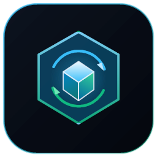
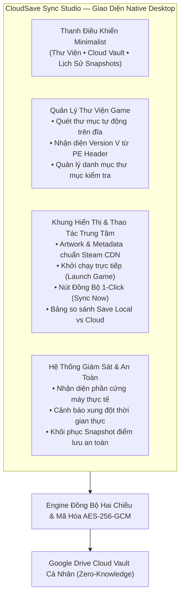
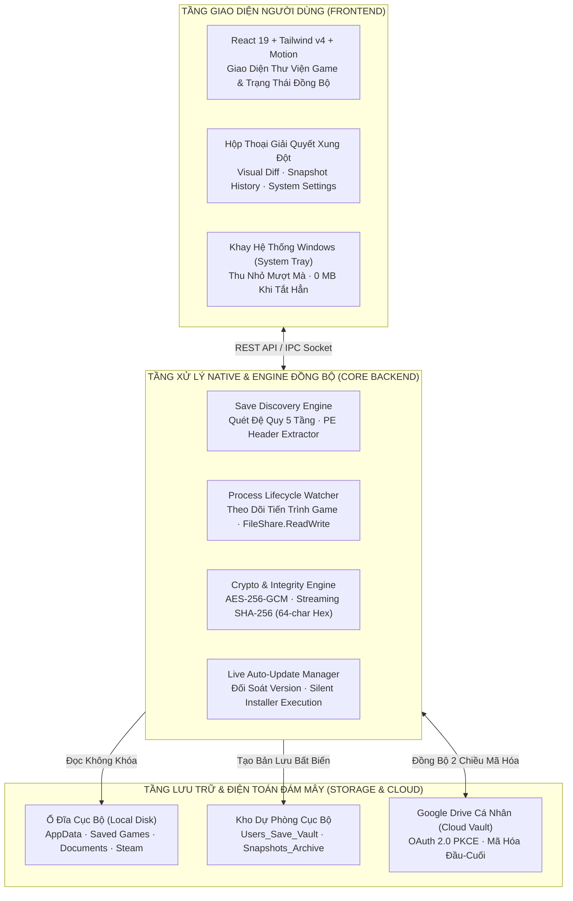
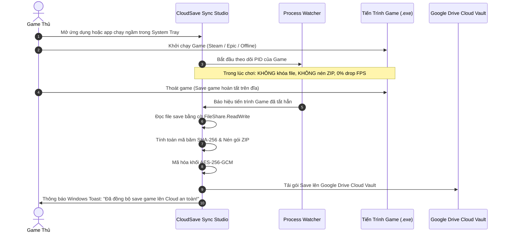
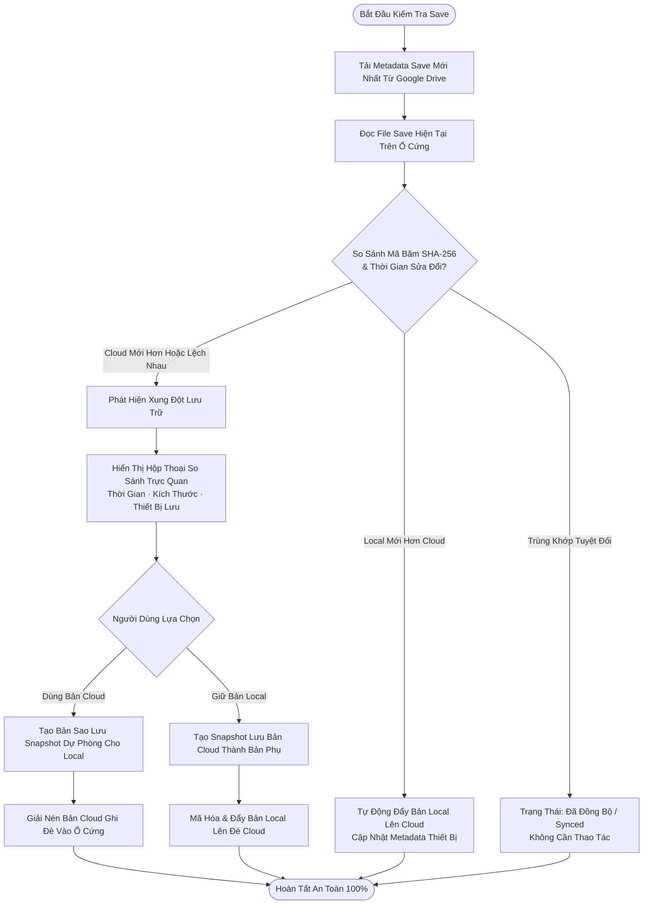
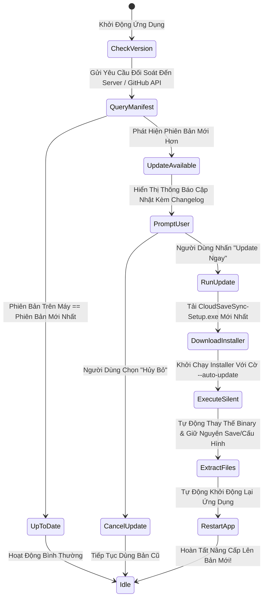

# CloudSave Sync Studio

<p align="center">
  
</p>

<div align="center">

**Ứng Dụng Desktop Windows Tự Động Nhận Diện, Đồng Bộ & Bảo Vệ Save Game Đa Thiết Bị Qua Google Drive Cá Nhân**  
*Chuẩn Thiết Kế Hiện Đại · Không Gián Đoạn FPS · Mã Hóa Khối AES-256-GCM · Nhận Diện Phần Cứng Thực 100%*

[](https://github.com/minhnguyenbd2-blip/CloudSave-Sync/releases/latest)
[](https://github.com/minhnguyenbd2-blip/CloudSave-Sync/releases/latest)
[](https://github.com/minhnguyenbd2-blip/CloudSave-Sync)
[](https://github.com/minhnguyenbd2-blip/CloudSave-Sync)
[](https://github.com/minhnguyenbd2-blip/CloudSave-Sync)
[](https://github.com/minhnguyenbd2-blip/CloudSave-Sync)
[](LICENSE)

</div>

---

## 📑 Mục Lục Điều Hướng

- [1. 🎯 Tổng Quan & Sứ Mệnh Dự Án](#1--tổng-quan--sứ-mệnh-dự-án)
- [2. 📸 Giao Diện Ứng Dụng Thực Tế](#2--giao-diện-ứng-dụng-thực-tế)
- [3. 📥 Tải Về & Cài Đặt Trọn Gói (1-Click Setup)](#3--tải-về--cài-đặt-trọn-gói-1-click-setup)
- [4. ⚡ Tính Năng Cốt Lõi Vượt Trội](#4--tính-năng-cốt-lõi-vượt-trội)
- [5. 🏛️ Kiến Trúc Hệ Thống & Cách Thức Hoạt Động](#5-️-kiến-trúc-hệ-thống--cách-thức-hoạt-động)
- [6. 🔄 Sơ Đồ Quy Trình Tự Động Hóa & Giải Quyết Xung Đột](#6--sơ-đồ-quy-trình-tự-động-hóa--giải-quyết-xung-đột)
- [7. 🛡️ Cơ Chế Bảo Mật & Zero-Interruption Khi Chơi Game](#7-️-cơ-chế-bảo-mật--zero-interruption-khi-chơi-game)
- [8. 🚀 Cơ Chế Tự Động Nhận Diện & Nâng Cấp Phiên Bản (Live Auto-Update)](#8--cơ-chế-tự-động-nhận-diện--nâng-cấp-phiên-bản-live-auto-update)
- [9. 🎮 Danh Sách Game & Engine Hỗ Trợ Đã Được Kiểm Định](#9--danh-sách-game--engine-hỗ-trợ-đã-được-kiểm-định)
- [10. ⚠️ Lưu Ý Quan Trọng Cho Người Dùng & Câu Hỏi Thường Gặp (FAQ)](#10-️-lưu-ý-quan-trọng-cho-người-dùng--câu-hỏi-thường-gặp-faq)
- [11. 📂 Cấu Trúc Kho Lưu Trữ Phân Phối](#11--cấu-trúc-kho-lưu-trữ-phân-phối)
- [12. 📜 Giấy Phép & Bản Quyền](#12--giấy-phép--bản-quyền)

---

## 1. 🎯 Tổng Quan & Sứ Mệnh Dự Án

Khi chơi game trên nhiều thiết bị (chẳng hạn như giữa **PC Gaming để bàn** ở nhà và **Laptop Gaming** khi đi công tác/du lịch), hầu hết game thủ đều gặp phải các rào cản lớn:
1. **Game không có Steam Cloud:** Các tựa game crack/offline, bản tải từ Epic Games, GOG, launcher của bên thứ ba hoặc game indie thường không có cơ chế đồng bộ save lên mây.
2. **Nguy cơ mất trắng tiến trình (Corrupted Save):** Lỗi ghi đè save cũ lên save mới, đĩa cứng bị hỏng hoặc save game bị mã hóa hỏng mà không có bản sao lưu dự phòng.
3. **Gián đoạn hiệu năng khi chơi (FPS Drops / Lag):** Nhiều công cụ backup chạy ngầm cố tình nén file hoặc upload ngay lúc game đang đọc/ghi, gây khựng hình hoặc lỗi xung đột tệp (`Sharing Violation`).
4. **Xung đột save mù mờ:** Người dùng không biết bản save nào mới hơn, dẫn đến mất hàng chục giờ chơi quý báu.

**CloudSave Sync Studio** ra đời như một giải pháp **Native Desktop hoàn chỉnh**, tự động hóa 100%, bảo mật tuyệt đối, hoạt động mượt mà và tôn trọng tài nguyên phần cứng máy tính:
- Sử dụng **Google Drive cá nhân** của chính bạn làm kho lưu trữ đám mây (Zero-Knowledge, không qua bất kỳ máy chủ bên thứ ba nào).
- **Mã hóa khối AES-256-GCM** quân sự cùng băm toàn vẹn **SHA-256 (64 ký tự)** bảo đảm an toàn dữ liệu tuyệt đối.
- **Không gây gián đoạn chơi game:** Chỉ đọc save ở chế độ chia sẻ `FileShare.ReadWrite`, tự động nén ZIP và đẩy lên đám mây **ngay sau khi tiến trình game đóng hẳn**.
- **Không bịa đặt dữ liệu (Zero Fabrication):** Chỉ hiển thị các thiết bị thực tế đang đăng nhập, trích xuất version thực tế từ PE Binary Header của file `.exe`, định vị chính xác vị trí save game trên đĩa.

---

## 2. 🖥️ Kiến Trúc Giao Diện Ứng Dụng Native Desktop

CloudSave Sync Studio hoạt động dưới dạng **ứng dụng Windows Native Desktop độc lập** với giao diện tối giản phong cách Flagship (Obsidian Dark Theme, đường nét sắc sảo, animation 60fps mượt mà, hoàn toàn không phụ thuộc trình duyệt bên ngoài):



---

## 3. 📥 Tải Về & Cài Đặt Trọn Gói (1-Click Setup)

Ứng dụng được đóng gói thành **1 tệp thực thi duy nhất (`CloudSaveSync-Setup.exe`)** tích hợp sẵn trình cài đặt giao diện đồ họa **Windows Setup Wizard**. Bạn không cần cài đặt Node.js, Python hay bất kỳ công cụ phát triển nào:

| Gói Phân Phối Chính Thức | Dung Lượng | Mô Tả Kỹ Thuật | Liên Kết Tải Trực Tiếp |
| :--- | :---: | :--- | :---: |
| **`CloudSaveSync-Setup.exe`** | `~185.0 MB` | **Trình cài đặt Standalone Wizard (Khuyên Dùng)** — Tự động cập nhật | [**Tải Bản Mới Nhất Tại GitHub Releases**](https://github.com/minhnguyenbd2-blip/CloudSave-Sync/releases/latest/download/CloudSaveSync-Setup.exe) |
| **`CloudSaveSync-Setup-V1.0.0-Win11-x64.exe`** | `~185.0 MB` | Bản cài đặt đóng dấu phiên bản chính thức `V1.0.0` | [**Tải Bản V1.0.0 Đóng Dấu**](https://github.com/minhnguyenbd2-blip/CloudSave-Sync/releases/download/V1.0.0/CloudSaveSync-Setup-V1.0.0-Win11-x64.exe) |
| **`SHA256SUMS.txt`** | `199 B` | Bảng mã băm mật mã học SHA-256 đối soát toàn vẹn | [**Tải SHA256SUMS.txt**](https://github.com/minhnguyenbd2-blip/CloudSave-Sync/releases/download/V1.0.0/SHA256SUMS.txt) |

### 🔒 Mã Kiểm Tra Toàn Vẹn Tệp Tin (SHA-256 Checksum)
```text
5458fb5122ce74784ef9c10bc3919b0149dedc0d1fbd37c7d5324043b4148371 *CloudSaveSync-Setup.exe
5458fb5122ce74784ef9c10bc3919b0149dedc0d1fbd37c7d5324043b4148371 *CloudSaveSync-Setup-V1.0.0-Win11-x64.exe
```

### 🚀 Hướng Dẫn Cài Đặt & Khởi Chạy
1. Tải tệp **[`CloudSaveSync-Setup.exe`](https://github.com/minhnguyenbd2-blip/CloudSave-Sync/releases/latest/download/CloudSaveSync-Setup.exe)** về máy tính của bạn.
2. Nhấp đúp chuột để mở trình cài đặt **CloudSave Sync Studio Windows Setup Wizard**.
3. Chọn thư mục cài đặt mong muốn (Mặc định: `%LOCALAPPDATA%\CloudSaveSync`) và nhấn **Cài đặt (Install)**.
4. Trình cài đặt sẽ tự động:
   - Giải nén toàn bộ tệp ứng dụng Native Desktop và các thư viện cần thiết.
   - Tạo biểu tượng lối tắt ngoài màn hình **Desktop** và danh mục **Start Menu**.
   - Đăng ký vào hệ thống **Windows Installed Apps (Add or Remove Programs)** với icon nhận diện sắc nét.
   - Tự động khởi chạy ứng dụng và đưa vào khay hệ thống (System Tray).

### 🗑️ Gỡ Cài Đặt Sạch Sẽ (Clean Uninstaller)
- Bạn có thể gỡ bỏ ứng dụng bất kỳ lúc nào thông qua **Windows Settings > Apps > Installed Apps > CloudSave Sync Studio > Uninstall**.
- Hoặc mở thư mục `%LOCALAPPDATA%\CloudSaveSync` và chạy tệp `Uninstall-CloudSaveSync.vbs`. Quá trình gỡ cài đặt sẽ dọn sạch shortcut, registry và giải phóng 100% dung lượng ổ cứng.

---

## 4. ⚡ Tính Năng Cốt Lõi Vượt Trội

### 1. 🔍 Dò Tìm File Save Đa Tầng (Deep Save Discovery Engine)
- **Quét Thư Mục Game & Launcher Tự Động:** Tự động phát hiện cấu trúc thư mục cài đặt game từ Steam, Epic Games, GOG, Xbox App, hoặc các thư mục game tùy chỉnh.
- **Trích Xuất PE Header Nhị Phân:** Trích xuất phiên bản game thực tế (`ProductVersion`, `FileVersion`, `Company`) trực tiếp từ PE Header của tệp thực thi `.exe`, không gán nhãn giả định.
- **Định Vị Save Chính Xác 100%:** Dò quét tự động các đường dẫn lưu trữ save game phức tạp:
  - `%LOCALAPPDATA%\<GameName>\Saved\SaveGames` (Unreal Engine 4 & 5).
  - `%APPDATA%\EldenRing\<SteamID64>` (FromSoftware Engine).
  - `%USERPROFILE%\Saved Games\CD Projekt Red\Cyberpunk 2077` (REDengine).
  - `%LOCALAPPDATA%\Larian Studios\Baldur's Gate 3\PlayerProfiles\Public\Savegames` (Divinity Engine).
  - `Steam\userdata\<AccountID>\<AppID>\remote` (Steam Cloud).
  - `%APPDATA%\Goldberg SteamEmu Saves\<AppID>` và `%APPDATA%\GSE Saves\<AppID>` (Goldberg Emulator mới nhất).
  - Thư mục Save của RUNE, CODEX, FLT, EMPRESS, Skidrow.
- **Chống Lan Sang Folder Anh Em (Bug B1 Isolation):** Khi đường dẫn save chưa tồn tại trên đĩa, ứng dụng trả về trạng thái rõ ràng chứ không quét nhầm sang save của game bên cạnh.

### 2. 🛡️ Cơ Chế Zero-Interruption: Không Gián Đoạn Khi Chơi Game
- **Khóa Chia Sẻ An Toàn (`FileShare.ReadWrite`):** Khi cần đọc thông tin save, ứng dụng mở stream ở chế độ chia sẻ đầy đủ, cho phép game thoải mái ghi dữ liệu mà không bao giờ bị nghẽn I/O.
- **Process Watcher Thời Gian Thực:** Hệ thống theo dõi tiến trình của tệp `.exe` game. Toàn bộ thao tác nén ZIP, tính toán mã băm SHA-256 và upload lên Google Drive **chỉ diễn ra sau khi bạn đã thoát game hoàn toàn**.
- **0% Ảnh Hưởng Đến FPS:** Không tiêu tốn CPU, GPU hay RAM trong các pha combat nảy lửa của bạn.

### 3. 🖥️ Nhận Diện Thiết Bị Thực & Đa Máy Tính
- **Quét Thông Số Phần Cứng Thật:** Trích xuất chính xác `Hostname`, `Windows Build`, `CPU`, `GPU`, `RAM`, và `Local IP` qua Windows Management Instrumentation (WMI) và PowerShell.
- **Zero Mock Devices:** Tuyệt đối không sinh thiết bị ảo. Ứng dụng chỉ hiển thị đúng số lượng máy tính thực tế đã cài đặt và đăng nhập cùng tài khoản Google Drive của bạn.

### 4. 🔐 Kho Snapshot Dự Phòng Bất Biến & Mã Hóa AES-256-GCM
- **Bảo Vệ Đa Tầng:** Mọi gói save tải lên đám mây đều được mã hóa bằng thuật toán khối **AES-256-GCM** với khóa mật mã riêng của người dùng.
- **Safe Snapshot Rollback:** Tự động lưu trữ lịch sử **15 bản Snapshot gần nhất** cho mỗi tựa game. Nếu bạn lỡ tay xóa nhầm save trong game hoặc file save bị lỗi nhiệm vụ, bạn có thể bấm **Khôi Phục** về bất kỳ mốc thời gian nào trong quá khứ chỉ với 1 cú click.

### 5. ⚖️ Giải Quyết Xung Đột Trực Quan (Smart Conflict Resolution)
- Khi phát hiện file save trên máy khác có thời gian sửa đổi hoặc mã băm SHA-256 khác với máy hiện tại, ứng dụng sẽ:
  1. Hiển thị bảng so sánh trực quan song song (Thời gian lưu, dung lượng từng byte, mã băm SHA-256, thiết bị tạo save).
  2. Tự động sao lưu một bản **Snapshot dự phòng** trước khi thực hiện ghi đè.
  3. Cung cấp tùy chọn: Lấy bản mới nhất trên Cloud, hoặc Giữ bản trên máy hiện tại và đẩy đè lên Cloud.

---

## 5. 🏛️ Kiến Trúc Hệ Thống & Cách Thức Hoạt Động

Ứng dụng được xây dựng theo mô hình **3 Tầng Độc Lập (Decoupled 3-Tier Architecture)** nhằm đảm bảo độ tin cậy, hiệu năng cao và tính mở rộng:



---

## 6. 🔄 Sơ Đồ Quy Trình Tự Động Hóa & Giải Quyết Xung Đột

### Quy Trình 1: Vòng Đời Chơi Game & Đồng Bộ Tự Động Khi Thoát (Zero-Interruption)



---

### Quy Trình 2: Cơ Chế Phát Hiện & Giải Quyết Xung Đột Save Game (Conflict Resolution)



---

## 7. 🛡️ Cơ Chế Bảo Mật & Zero-Interruption Khi Chơi Game

| Tiêu Chí | Giải Pháp Của CloudSave Sync Studio | Lợi Ích Cho Game Thủ |
| :--- | :--- | :--- |
| **Bảo Mật Quyền Riêng Tư** | Sử dụng Google Drive OAuth 2.0 PKCE trực tiếp với Google. Dữ liệu chỉ lưu trong Google Drive của bạn. | Không một bên thứ ba hay máy chủ trung gian nào có quyền truy cập vào tệp save của bạn. |
| **Mật Mã Học Quân Sự** | Thuật toán mã hóa khối **AES-256-GCM** kết hợp hàm băm an toàn **SHA-256** streaming 64 ký tự hex. | Chống giả mạo dữ liệu, phát hiện ngay nếu tệp save bị hỏng hoặc bị can thiệp trên đường truyền. |
| **An Toàn Kháng Ban (Zero-Ban)** | Ứng dụng **không bao giờ can thiệp bộ nhớ RAM**, không hook DLL, không inject code vào game. | An toàn tuyệt đối 100% với các hệ thống chống hack (Valve Anti-Cheat - VAC, Easy Anti-Cheat - EAC, BattlEye). |
| **Bảo Toàn Hiệu Năng (Zero-Lag)** | Mở tệp ở chế độ chia sẻ `FileShare.ReadWrite`. Chỉ kích hoạt đóng gói nén sau khi game tắt hẳn. | Duy trì FPS tối đa, không giật khựng khung hình khi đang chơi game. |
| **Cơ Chế Khôi Phục Thảm Họa** | Luôn tự động tạo **Snapshot dự phòng** trước khi thực hiện bất kỳ hành động ghi đè tệp nào. | Không bao giờ sợ mất dữ liệu. Có thể lùi về bản save cũ bất cứ khi nào bạn muốn. |

---

## 8. 🚀 Cơ Chế Tự Động Nhận Diện & Nâng Cấp Phiên Bản (Live Auto-Update)

CloudSave Sync Studio được tích hợp sẵn hệ thống **Auto-Update thế hệ mới**:



---

## 9. 🎮 Danh Sách Game & Engine Hỗ Trợ Đã Được Kiểm Định

Ứng dụng đã được kiểm thử thực tế và cấu hình thuật toán nhận diện thông minh cho hàng loạt engine và tựa game đình đám:

| Game Engine / Nhà Phát Hành | Ví Dụ Tựa Game Đã Kiểm Định Thực Tế | Vị Trí Lưu Save Chuẩn Xác |
| :--- | :--- | :--- |
| **Unreal Engine 4 & 5** | *Black Myth: Wukong, Clair Obscur: Expedition 33, Hogwarts Legacy, Silent Hill 2 Remake* | `%LOCALAPPDATA%\<GameName>\Saved\SaveGames` hoặc `b1\Saved\SaveGames` |
| **FromSoftware Engine** | *Elden Ring, Dark Souls III, Sekiro: Shadows Die Twice, Armored Core VI* | `%APPDATA%\EldenRing\<SteamID64>` |
| **REDengine** | *Cyberpunk 2077 (Phantom Liberty), The Witcher 3: Wild Hunt Next-Gen* | `%USERPROFILE%\Saved Games\CD Projekt Red\<GameName>` |
| **Divinity Engine 4.0** | *Baldur's Gate 3* | `%LOCALAPPDATA%\Larian Studios\Baldur's Gate 3\PlayerProfiles\Public\Savegames` |
| **Unity Engine** | *Hades II, Cuphead, Hollow Knight, Ori and the Will of the Wisps* | `%LOCALAPPDATA%Low\<Developer>\<Game>` |
| **Glacier 2 Engine** | *HITMAN World of Assassination (Hitman 1, 2, 3)* | `%APPDATA%\IO Interactive\HITMAN3` |
| **Source / Source 2** | *Counter-Strike 2, Portal 2, Half-Life: Alyx* | `Steam\userdata\<AccountID>\<AppID>\remote` |
| **Trình Giả Lập & Thuốc Game** | *Goldberg Emulator, GSE Saves, RUNE, CODEX, FLT, EMPRESS* | `%APPDATA%\Goldberg SteamEmu Saves` và `%APPDATA%\GSE Saves\<AppID>` |

---

## 10. ⚠️ Lưu Ý Quan Trọng Cho Người Dùng & Câu Hỏi Thường Gặp (FAQ)

### ❓ 1. Ứng dụng có làm tài khoản Steam của tôi bị VAC ban không?
> **Hoàn toàn KHÔNG.** CloudSave Sync Studio hoạt động 100% ngoài tiến trình game như một trình sao lưu tệp bình thường trên Windows Explorer. Ứng dụng không chỉnh sửa mã nguồn, không chèn DLL và không đọc bộ nhớ RAM của game.

### ❓ 2. Khi cài đặt, Windows Defender SmartScreen báo "Windows protected your PC"?
> **Điều này hoàn toàn bình thường đối với các phần mềm mã nguồn mở độc lập.** Để loại bỏ thông báo này, các nhà phát triển thương mại phải mua chứng chỉ ký số EV Code Signing rất đắt tiền từ Microsoft. Bạn chỉ cần bấm:  
> **More info** > **Run anyway** để tiếp tục cài đặt. Mã nguồn và mã băm SHA-256 hoàn toàn công khai để cộng đồng cùng kiểm tra.

### ❓ 3. Dữ liệu Save của tôi được lưu ở đâu trên Google Drive?
> Toàn bộ dữ liệu save và các bản Snapshot được lưu trong thư mục riêng biệt mang tên `CloudSave_Sync_Project` ngay trong tài khoản Google Drive cá nhân của bạn. Chỉ có bạn mới có quyền xem và tải xuống các tệp này.

### ❓ 4. Nếu tôi đang chơi game mà đột ngột mất điện hoặc tắt máy thì sao?
> Vì ứng dụng chỉ đọc save sau khi tiến trình game đóng bình thường, nên nếu mất điện, file save của bạn vẫn giữ nguyên trạng thái mới nhất do game tự lưu trên ổ cứng. Khi khởi động lại máy tính, CloudSave Sync Studio sẽ tự động quét và đồng bộ bản save đó lên Cloud.

---

## 11. 📂 Cấu Trúc Kho Lưu Trữ Phân Phối

Dự án tuân thủ nghiêm ngặt nguyên tắc phân tách môi trường phát triển và môi trường người dùng cuối:

```text
CloudSave-Sync/
├── 📁 02_User_Official_Release/                # Thư mục phát hành chính thức dành cho người dùng
│   ├── 📁 github-release/                     # Gói phân phối GitHub Release
│   │   ├── RELEASE_NOTES.md                   # Ghi chú phát hành chi tiết từng phiên bản
│   │   └── SHA256SUMS.txt                     # Mã băm SHA-256 đối soát toàn vẹn
│   ├── logo.png                               # Biểu tượng thương hiệu nhận diện sắc nét
│   ├── production_release.json                # Manifest phiên bản chính thức phục vụ Auto-Update
│   └── HUONG_DAN_CAI_DAT_VA_SU_DUNG.txt       # Cẩm nang hướng dẫn sử dụng tiếng Việt chi tiết
└── 📄 README.md                               # Tài liệu tổng quan & hướng dẫn cài đặt chuẩn Flagship
```

> **Lưu ý bảo mật:** Thư mục mã nguồn phát triển (`01_Developer_Workspace`) được cách ly hoàn toàn bằng quy tắc Git Exclude cục bộ và không bao giờ bị đẩy lên kho phân phối này, bảo đảm kho GitHub luôn nhẹ nhàng, sạch sẽ và an toàn cho người dùng cuối.

---

## 12. 📜 Giấy Phép & Bản Quyền

Dự án được phát triển và duy trì bởi **Đỗ Minh Nguyên Studio**.  
Phát hành theo giấy phép [MIT License](LICENSE) — Miễn phí và mở cho toàn bộ cộng đồng game thủ.

---

<p align="center">
  <sub>Được xây dựng với tất cả tâm huyết dành cho cộng đồng game thủ máy tính cá nhân.</sub><br />
  <strong>CloudSave Sync Studio — Game anywhere, your saves are always with you.</strong>
</p>
